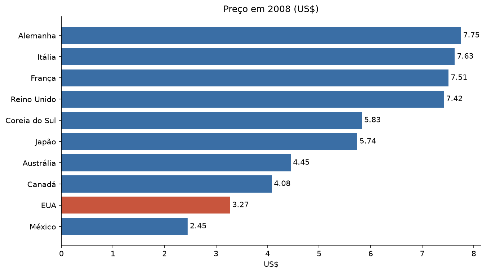

# Preço do combustível em 10 países (1990 a 2008)

Análise em Python e SQL que compara a alta percentual do combustível com o preço final em cada país.

**Pergunta:** subir mais em porcentagem significa terminar mais caro? Nem sempre: os EUA tiveram a terceira maior alta do período e, mesmo assim, foram o segundo país mais barato em 2008.



## Principais resultados

| País | 1990 (US$) | 2008 (US$) | Variação | Crescimento anual composto |
| --- | --- | --- | --- | --- |
| Alemanha | 2,65 | 7,75 | +192,5% | 6,14% |
| Coreia do Sul | 2,05 | 5,83 | +184,4% | 5,98% |
| EUA | 1,16 | 3,27 | +181,9% | 5,93% |
| Reino Unido | 2,82 | 7,42 | +163,1% | 5,52% |
| México | 1,00 | 2,45 | +145,0% | 5,10% |
| Austrália* | 1,96 | 4,45 | +127,0% | 4,94% |
| Canadá | 1,87 | 4,08 | +118,2% | 4,43% |
| França | 3,63 | 7,51 | +106,9% | 4,12% |
| Japão | 3,16 | 5,74 | +81,6% | 3,37% |
| Itália | 4,59 | 7,63 | +66,2% | 2,86% |

\* A Austrália não tem dado de 1990, então parte de 1991.

- A Alemanha custava 2,37 vezes o preço dos EUA em 2008.
- A alta se concentrou em 2003 a 2005, com variação média de 13% a 15% ao ano.
- O Reino Unido foi o país mais caro em 10 dos 19 anos.

## Como foi feito

1. Conferência da base (19 anos, 10 países, um valor ausente, que não foi preenchido).
2. Gráficos em Python, com pandas e Matplotlib.
3. Consultas em SQL com CTEs e funções de janela (`LAG` e `RANK`), em um SQLite em memória. Estão em [`sql/consultas.sql`](sql/consultas.sql).

A análise completa está em [`gas_price.ipynb`](gas_price.ipynb).

## Como rodar

```bash
pip install -r requirements.txt
jupyter notebook gas_price.ipynb
```

## Limites

Os valores são nominais e em dólar, então inflação e câmbio afetam a comparação. A base não documenta a unidade de volume nem a origem dos dados. A análise descreve o que aconteceu, sem explicar a causa.
